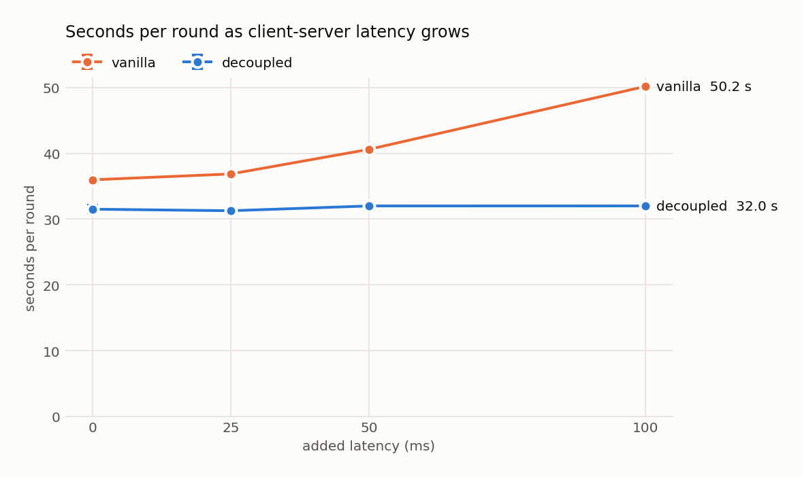
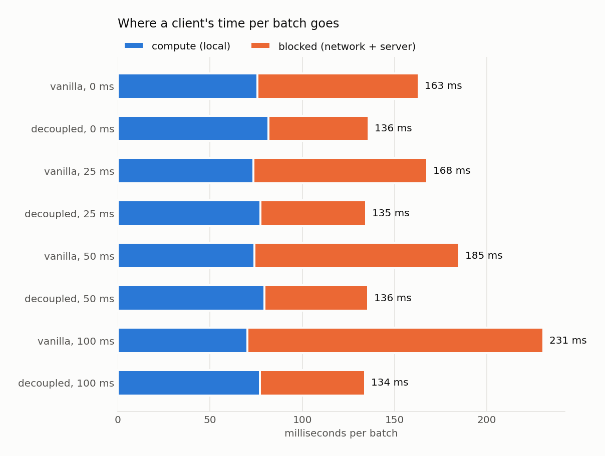
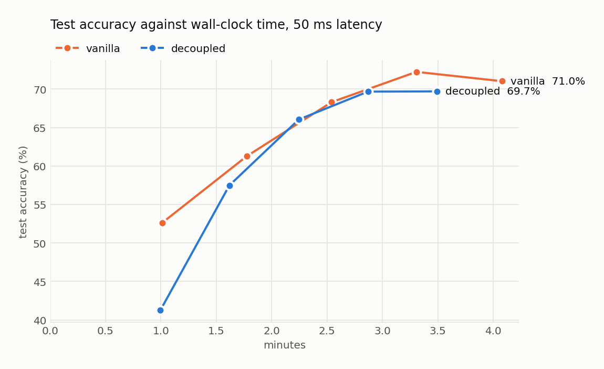
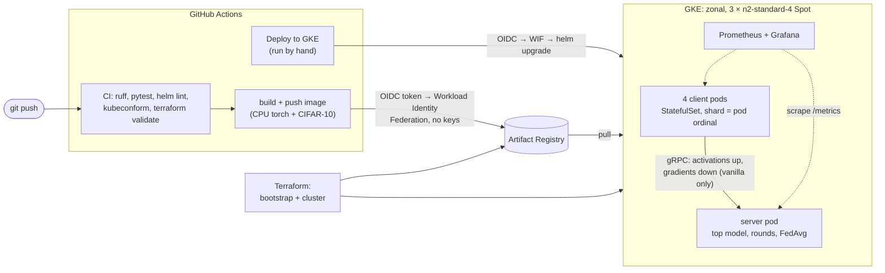

# KubeSplit

Kubernetes-native split learning. A gRPC server holds the top of a CNN;
N client pods hold the bottom and train on their own CIFAR-10 shard. Two modes:

- **vanilla**: the client sends activations, then waits for gradients on every batch.
- **decoupled**: the client trains its bottom with a local auxiliary head
  (Decoupled Greedy Learning) and streams activations one way.

After each round the client bottoms are averaged with FedAvg, weighted by sample count.
A round closes when a quorum of clients has reported or a timeout fires.


*A real session on kind, replayed with pauses shortened ([`scripts/record_demo.py`](scripts/record_demo.py); `docs/demo.cast` plays in asciinema).*

## Results

Measured on GKE: 3 × `n2-standard-4` Spot VMs, a 2-CPU server and 4 one-CPU clients,
CIFAR-10 for 5 epochs, 3 runs per configuration. Method and raw data are in
[benchmarks/](benchmarks/README.md).

- **Latency barely touches decoupled training.** From 0 to 100 ms of added
  client-server latency, a vanilla round grows from 36.0 s to 50.2 s (+39%) while a
  decoupled round stays at 31.5–32.0 s. Decoupled rounds are 12% shorter with no
  added latency, 21% shorter at 50 ms and 36% shorter at 100 ms.
- **Half the traffic.** A 5-epoch vanilla run moves 7.6 GiB between clients and
  server: 3.8 GiB of activations up and 3.8 GiB of gradients down. Decoupled sends
  the activations only.
- **Same accuracy.** Every configuration averages 68.8–71.9% test accuracy after
  5 epochs; the gap between modes is within run-to-run noise.
- **Decoupled is bound by the server, not the network.** Its batches wait ~117 ms
  for the shared top model: 4 clients × 196 batches × ~40 ms per step is the 32 s
  round. More server CPU, not a faster network, would speed it up. Vanilla's
  clients wait less in that queue as latency grows (36 → 9 ms at 50 ms), which is
  why small delays cost it little at first.
- **Recovery.** A killed client pod rejoins ~6 s later and its round still closes
  on schedule (38.6 s after the kill, about one normal round). A killed server is
  replaced and all clients rejoin its new run in 12.3 s, down from 25.4 s after
  capping gRPC's reconnect backoff and probing readiness every second; training
  moves again after 48.7 s (was 61.3 s).

<picture>
  <source media="(prefers-color-scheme: dark)" srcset="docs/img/round-time-vs-latency-dark.png">
  
</picture>

<picture>
  <source media="(prefers-color-scheme: dark)" srcset="docs/img/batch-time-split-dark.png">
  
</picture>

<picture>
  <source media="(prefers-color-scheme: dark)" srcset="docs/img/accuracy-over-time-dark.png">
  
</picture>

The full tables are in [benchmarks/gke/results.md](benchmarks/gke/results.md).

## Architecture



## Quick start

```bash
pip install -e ".[dev]"
make test             # pytest, ~1 min on CPU, no download
make baseline-quick   # both modes in one process, synthetic data
make baseline         # both modes in one process, real CIFAR-10 -> results/baseline.csv
make local MODE=vanilla    # server + 4 client processes over gRPC, no Docker
make compose-both          # server + 4 client containers, vanilla then decoupled
make image                 # kubesplit:dev, CIFAR-10 included (downloads it first if missing)
```

The image carries CIFAR-10 so pods never download it: the build copies
`data/cifar-10-batches-py` (from `python -m kubesplit prepare-data`) and checks every
file's MD5, so a missing or corrupt copy fails the build.

Without `make` (e.g. Windows): `python -m kubesplit {server,client,baseline} --help`
and `python scripts/local_run.py --help`.

## Run on Kubernetes (kind)

Needs Docker, [kind](https://kind.sigs.k8s.io/), kubectl and Helm. Uses synthetic data
for speed (`--set run.dataset=cifar10` trains on the real images baked into the image);
fits a 6-CPU / 7 GiB Docker Desktop. With CIFAR-10 a client peaks at ~650 of its 768 MiB.

```bash
make kind-up        # one-node cluster in Docker
make monitoring     # kube-prometheus-stack: Prometheus Operator, Prometheus, Grafana
make demo           # build + load the image, helm install, wait until all pods are ready
kubectl logs -f deployment/kubesplit-server   # watch rounds close
make prometheus-ui  # http://localhost:9090, try: kubesplit_round or up{job=~"kubesplit-.*"}
make grafana-ui     # http://localhost:3000, dashboard "KubeSplit"
make pod-kill TARGET=server   # kill a pod mid-round and time the recovery
make kind-down      # delete the cluster
```

The chart's `ServiceMonitor` (enabled in `deploy/kind/values.yaml`) makes Prometheus
scrape the server and every client pod every 5 s, labelled `component="server"|"client"`.
Its `grafanaDashboard` ConfigMap is loaded by Grafana's sidecar as the **KubeSplit**
dashboard: run progress, client compute vs blocked time per batch, traffic by message
kind, server queueing, and each pod's CPU, throttling and memory against its limits.
Log in as `admin`; the password is in a secret:

```bash
kubectl -n monitoring get secret monitoring-grafana -o jsonpath="{.data.admin-password}" | base64 -d
```

```powershell
[Text.Encoding]::UTF8.GetString([Convert]::FromBase64String((kubectl -n monitoring get secret monitoring-grafana -o jsonpath="{.data.admin-password}")))
```

Without `make`, run the commands under those targets in the `Makefile`. Server and
clients stay up after training (`KS_EXIT_ON_DONE=false`) so their metrics remain
scrapeable. A new run starts whenever a `run.*` value changes:
`helm upgrade kubesplit charts/kubesplit -f deploy/kind/values.yaml --set run.mode=vanilla`.

### Killing pods

`scripts/pod_kill.py` waits until a chosen round is open, deletes the server or one
client mid-round, and times each stage of recovery. It reads progress from the
server's `/metrics` through the Kubernetes API, so it needs only kubectl. With
`--out` it appends a CSV row per run. Measured on kind (decoupled, 4 clients,
synthetic data, one ~5 s round as the baseline):

| Seconds after the kill | client-2 | server |
|---|---|---|
| replacement pod running | 2.6 | 1.9 |
| old pod gone | 2.0 | 5.2 |
| replacement server answering | | 12.5 |
| rejoined (server: all 4 clients) | 10.5 | 19.0 |
| a round closes: training moves again | 17.9 | 23.9 (new run, 9 rounds lost) |

No pod restarted in either case: clients rejoin in-process (see below). Recovery on
GKE, with real CIFAR-10 rounds, is under [Results](#results).

## CI/CD and GKE

| Workflow | When | What |
|---|---|---|
| `ci.yml` | every push and pull request | ruff; generated code matches its sources; pytest; `helm lint` + kubeconform; `terraform fmt`/`validate` |
| `ci.yml`, job `image` | push to `main`, once wired to GCP | build the image (CIFAR-10 included) and push `<sha>` and `main` tags to Artifact Registry |
| `deploy.yml` | by hand (Actions tab) | `helm upgrade --install` on GKE with the chosen mode, clients, rounds and network delay |

No GCP key exists anywhere: GitHub signs a short-lived OIDC token for each run,
and Workload Identity Federation exchanges it for credentials of a service
account that can push to one image repository and deploy into clusters, but
only for tokens from this repository. The infrastructure is two Terraform
stacks, a long-lived `bootstrap` and an ephemeral benchmark `cluster` (a zonal GKE
cluster on Spot VMs); see [infra/README.md](infra/README.md).

Setting it up, once: apply `infra/bootstrap`, set the repository variables it
prints, apply `infra/cluster`, run `make gke-monitoring`, then run **Deploy to
GKE** from the Actions tab. `terraform destroy` in `infra/cluster` when done.

## How a round works

```
client                                     server
  Join(shard)  ───────────────────────────▶  returns RunConfig (mode, partition, lr, ...)
  WaitRound(last) ────────────────────────▶  long-poll until a newer round opens
               ◀────────────────────────────  round r + global bottom weights
  vanilla:   Step(acts)  ─────────────────▶  top fwd/bwd
             ◀──────────────── grad at cut   (one round trip per batch)
  decoupled: StreamActivations(acts...) ──▶  top fwd/bwd, nothing sent back
  SubmitUpdate(weights, n) ───────────────▶  quorum reached or timeout -> FedAvg,
                                             evaluate, write results row, open r+1
```

The server owns the config, so clients only need `KS_SERVER` and a shard. The
shard defaults to the hostname's trailing ordinal (`kubesplit-client-3` → 3).
Late updates for a closed round are discarded; the straggler joins the next round.

**When pods die.** A replacement client pod rejoins and trains the current round.
The server keeps no state on disk, so a replacement server starts a new run from
round 1. Each server process has a random `server_id`, which Join and WaitRound
return. When a client sees a different ID, or the server drops a call
(`UNAVAILABLE`), it joins again in-process instead of crashing, so Kubernetes never
restarts it. While the server is down, clients retry the connection at least every
2 s (gRPC's default backoff grows past the ~10 s a new server pod needs), and the
server's readiness probe runs every second, so its Service takes traffic as soon
as it listens. Both roles exit on SIGTERM within about a second.
Tensors travel as dtype + shape + raw bytes (`kubesplit/tensors.py`), never pickle.

## Configuration

Every flag also reads a `KS_*` environment variable: `KS_MODE`, `KS_CLIENTS`,
`KS_ROUNDS`, `KS_QUORUM_PCT`, `KS_ROUND_TIMEOUT`, `KS_PARTITION`, `KS_ALPHA`,
`KS_DATASET` (`cifar10`/`fake`), `KS_MAX_BATCHES`, `KS_SERVER`, `KS_SHARD`, `KS_THREADS`,
`KS_METRICS_PORT` (default 8000; 0 turns metrics off).
Torch sizes its thread pool from the container's cgroup CPU quota, not the host core count.

On Kubernetes, `run.netDelayMs` adds network latency between clients and server. Each
client pod gets an init container that runs `tc qdisc replace dev eth0 root netem delay
<N>ms` in the pod's network namespace, so every packet the client sends waits N ms: N ms
more round-trip time to the server. Only that init container runs as root with
`NET_ADMIN`; the client itself keeps every capability dropped. Changing the value
restarts server and clients as a new run, like any `run.*` value.

Measured on kind (4 clients, synthetic data) with `run.netDelayMs=50`: a TCP connect
from a client pod to the server takes 50.3 ms instead of 0.7 ms. Per batch, a vanilla
client's blocked time rose from 233 to 396 ms: 163 ms more for 50 ms of latency, because
each `Step` moves ~1 MiB each way and HTTP/2 flow control needs several round trips to
do it. A decoupled client's blocked time went from 9 to 14 ms.

Results: one CSV per run in `results/`, one row per round: test accuracy, train
loss and accuracy, `bytes_up` / `bytes_down` / `bytes_sync` (serialized message sizes),
round time, and the number of clients that reported.

## Metrics

Every process serves Prometheus metrics at `:8000/metrics` (`kubesplit/metrics.py`).

| Server metric | Type | Answers |
|---|---|---|
| `kubesplit_round`, `kubesplit_training_done` | gauge | Where is training? |
| `kubesplit_round_duration_seconds` | histogram | How long does a round take? |
| `kubesplit_rounds_total{reason}` | counter | Do rounds close by quorum or by timeout? |
| `kubesplit_round_clients_reporting` | gauge | How many clients made the last round? |
| `kubesplit_late_updates_total` | counter | How often is a straggler's work thrown away? |
| `kubesplit_client_joins_total`, `kubesplit_clients_joined` | counter, gauge | Did a killed client come back? |
| `kubesplit_test_accuracy_ratio`, `kubesplit_train_loss` | gauge | Is the model learning? |
| `kubesplit_transferred_bytes_total{kind}` | counter | Bytes of activations, gradients, weights |
| `kubesplit_server_samples_total` | counter | Server throughput (use `rate()`) |
| `kubesplit_server_step_seconds` | histogram | Top-model compute per batch |
| `kubesplit_server_lock_wait_seconds` | histogram | How long batches queue for the shared top model |

| Client metric | Type | Answers |
|---|---|---|
| `kubesplit_client_batch_seconds{phase}` | histogram | Per batch: `compute` (local) vs `blocked` (network + server) |
| `kubesplit_client_samples_total` | counter | Client throughput (use `rate()`) |
| `kubesplit_client_round_seconds` | histogram | Time to train one round's shard |
| `kubesplit_client_idle_seconds` | histogram | Time waiting at the round barrier |
| `kubesplit_client_round` | gauge | Round this client is on |

## Layout

| Path | What |
|---|---|
| `proto/kubesplit/kubesplit.proto` | Wire protocol (`make proto` regenerates `kubesplit/*_pb2*.py`) |
| `kubesplit/model.py` | `ClientBottom` (3x32x32 → 64x8x8), `AuxHead`, `ServerTop` |
| `kubesplit/data.py` | CIFAR-10 loading, deterministic IID and Dirichlet(α) sharding |
| `kubesplit/split.py` | `ClientWorker` / `ServerWorker` (independent of transport), `fedavg` |
| `kubesplit/rounds.py` | `RoundCoordinator`: quorum, timeout, FedAvg, late-update rejection |
| `kubesplit/server.py`, `client.py` | gRPC services |
| `kubesplit/tensors.py` | Tensor ↔ protobuf without pickle |
| `kubesplit/baseline.py` | Single-process reference run of both modes |
| `Dockerfile`, `docker-compose.yml` | One CPU-only image for every role, CIFAR-10 included; 1 server + 4 clients |
| `charts/kubesplit/` | Helm chart; settings in `values.yaml`, validated by `values.schema.json` |
| `scripts/pod_kill.py` | Fault injection: kill a pod mid-round, time the recovery |
| `scripts/benchmark.py`, `plot_results.py` | Benchmark matrix (fresh install per run) and its charts and tables |
| `scripts/record_demo.py` | Records the README demo on kind: asciicast plus GIF (`make demo-gif`) |
| `benchmarks/` | Method, raw CSVs and results from GKE; charts in `docs/img/` |
| `scripts/make_dashboard.py` | Builds the chart's Grafana dashboard (`charts/kubesplit/dashboards/`) |
| `deploy/kind/` | Local cluster config and laptop-sized chart values |
| `deploy/gke/` | Chart and kube-prometheus-stack values for GKE |
| `infra/bootstrap/`, `infra/cluster/` | Terraform: registry, state, keyless CI; the GKE cluster |
| `.github/workflows/` | CI (checks, image push) and the manual GKE deploy |

Each sample crosses the cut as 64×8×8 float32 (16 KiB). Vanilla also returns
a gradient of the same size, so it moves about 2× the bytes of decoupled mode.
The interesting number is wall-clock time under network latency.
